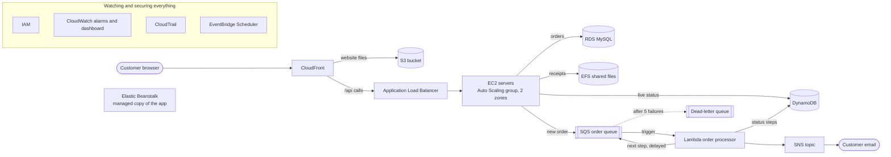
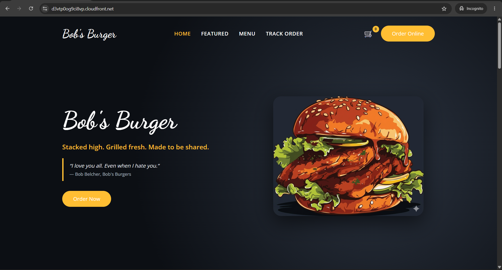

# Bob's Burger: an online food ordering system on AWS

A burger shop website where a customer picks burgers, places an order, gets confirmation emails and watches
the order move from **Received** to **Delivered**. I built it hands-on in 10 days as my AWS Cloud Computing
final project. The website is simple on purpose: the point of the project is the AWS architecture behind it.

> Built by: **YOUR NAME** | Course: AWS Cloud Computing | Region: `us-east-1`
>
> This is a student lab project. The live environment is deleted after the demo to stop AWS charges, so the
> site is not online any more. The code, the architecture and the lessons are all here.

## What the project does

1. The customer opens the website and chooses burgers (Two Hand, Normal, Special, Share boxes, Drinks).
2. The cart shows the total, with 10% off when 3 Two Hand or Special burgers are ordered.
3. The customer places the order. The server checks the prices itself, saves the order, and sends it to a queue.
4. A Lambda function picks the order up, emails the customer, and moves the status step by step:
   `RECEIVED` then `PREPARING` then `OUT_FOR_DELIVERY` then `DELIVERED`, one step per minute.
5. The customer can open the **Track Order** page with the order number and watch the status change.

## Architecture



**Why it is built this way**

| Choice | Reason |
| --- | --- |
| S3 + CloudFront for the site | Cheap static hosting, delivered from edge locations near the customer |
| Load balancer + Auto Scaling | Two servers in two zones: one can fail and customers never notice |
| RDS for orders, DynamoDB for status | RDS holds the order records. DynamoDB gives fast reads of the live status for the Track page |
| SQS between the website and Lambda | A slow or failing kitchen never loses an order. Failed messages go to a dead-letter queue and raise an alarm |
| Lambda + SNS | No server to run for processing and emails; pay only per run |
| EFS | One shared folder so every server writes receipts to the same place |
| IAM, CloudWatch, CloudTrail, EventBridge | Least-privilege access, alarms, an audit trail, and scheduled jobs (nightly stop, daily summary) |

## The AWS services used

VPC and security groups, EC2, Auto Scaling, Application Load Balancer, S3, CloudFront, RDS (MySQL),
DynamoDB, SQS (with a dead-letter queue), Lambda, SNS, EFS, Elastic Beanstalk, IAM, CloudWatch, CloudTrail
and EventBridge Scheduler.

## The 10-day journey

Full story, with what I built each day and what went wrong: **[docs/journey.md](docs/journey.md)**.

| Day | What I built | Services |
| --- | --- | --- |
| 1 | Understood the project and the architecture | Planning |
| 2 | Private network with public and private subnets | VPC, subnets, route tables, security groups |
| 3 | Deployed the website and Flask backend on one server | EC2, Gunicorn, systemd |
| 4 | Moved the website to S3 and put CloudFront in front | S3, CloudFront |
| 5 | Saved orders in a database and order status in a table | RDS, DynamoDB |
| 6 | Load balancing and automatic scaling across two zones | ALB, Auto Scaling, AMI |
| 7 | Queue, function and email: the order pipeline | SQS, Lambda, SNS |
| 8 | Shared receipts folder, and a managed deployment of the same app | EFS, Elastic Beanstalk |
| 9 | Access control, monitoring, audit and scheduled jobs | IAM, CloudWatch, CloudTrail, EventBridge |
| 10 | Final demo, viva and cleanup | Everything |

## What is in this repository

```
bobs-burger-aws/
  app/                      Flask backend (app.py), packages, systemd service, env example, database schema
  site/                     The website: index.html, menu.js (menu and slogan), app.js, style.css, track page
  lambda/                   order_processor.py (order steps), daily_summary.py, and their IAM policies
  iam/                      The policy that lets a user start and stop servers
  docs/                     journey.md, troubleshooting.md, demo-script.md, cleanup.md
  screenshots/              Evidence screenshots from the project
```

## Running it

The full step-by-step labs were written for a class, so this is the short version.

1. **Network and server:** create a VPC with two public and two private subnets, and launch an EC2 server.
2. **Backend:** copy `app/` to the server, create a virtualenv, `pip install -r requirements.txt`, copy
   `bobs-burger.env.example` to `/etc/bobs-burger.env` and fill in your own values, install
   `bobs-burger.service`, then `sudo systemctl enable --now bobs-burger`.
3. **Database:** run `app/schema.sql` against your RDS MySQL database. Create a DynamoDB table named
   `bobs-burger-order-status` with partition key `orderId`.
4. **Website:** upload `site/` to an S3 bucket, create a CloudFront distribution, and route `/api/*` to the backend.
5. **Pipeline:** create the SQS queue (with a dead-letter queue), the SNS topic, and the Lambda function from
   `lambda/order_processor.py` with the policy in `lambda/lambda-access-policy.json`. Set the environment
   variables `TABLE_NAME` and `TOPIC_ARN`, and add the queue as the Lambda trigger.
6. **Scale and watch:** build an AMI, a launch template, an Auto Scaling group behind a load balancer, then add
   CloudWatch alarms and the EventBridge schedules.

Every file that mentions an account number uses the placeholder `YOUR-ACCOUNT-ID`. Replace it with your own.

## Security notes

- No passwords, keys or account numbers are stored in this repository. The database password lives only in
  `/etc/bobs-burger.env` on the server (permissions `600`), never in the code.
- Each service has its own least-privilege role or security group. The database accepts connections only from the servers.
- The server recomputes prices itself, so a customer cannot change the total in the browser.

<!-- ## Screenshots



-->

## What I learned

- A queue between two parts of a system is what makes it reliable: a failure delays an order, it never loses one.
- DynamoDB has reserved words. `status` and `total` must be written as `#s` and `#t`, or the update fails.
- Check every layer when something breaks: browser, CloudFront, load balancer, server, database, queue, function.
- Security groups chained from the load balancer to the servers to the database keep each layer private.
- Cleanup matters: a load balancer, a stopped database and forgotten snapshots all keep costing money.

More in **[docs/troubleshooting.md](docs/troubleshooting.md)**.

## What I would improve next

- HTTPS with a certificate and a custom domain.
- A Multi-AZ database and the database password in Secrets Manager.
- A firewall (WAF) in front of CloudFront.
- Real kitchen and delivery updates instead of timed status steps.
- A CI/CD pipeline instead of copying files by hand.

## Cost and cleanup

The project fits the AWS free tier only if resources are stopped between sessions. See
**[docs/cleanup.md](docs/cleanup.md)** for the exact delete order.

## License

Code: MIT, see [LICENSE](LICENSE). The burger photos and calorie sheets used in the real site are not included.
